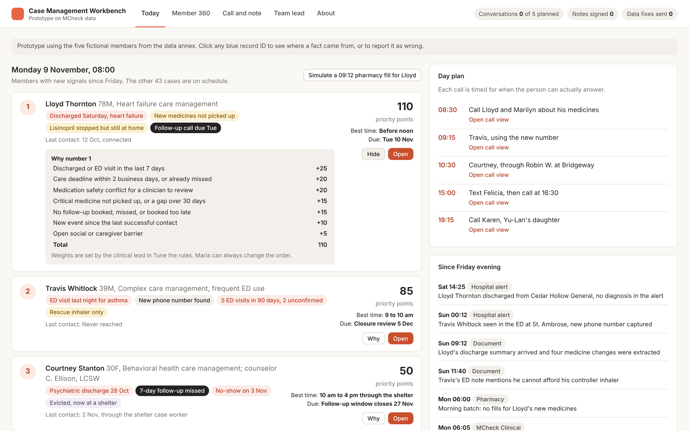
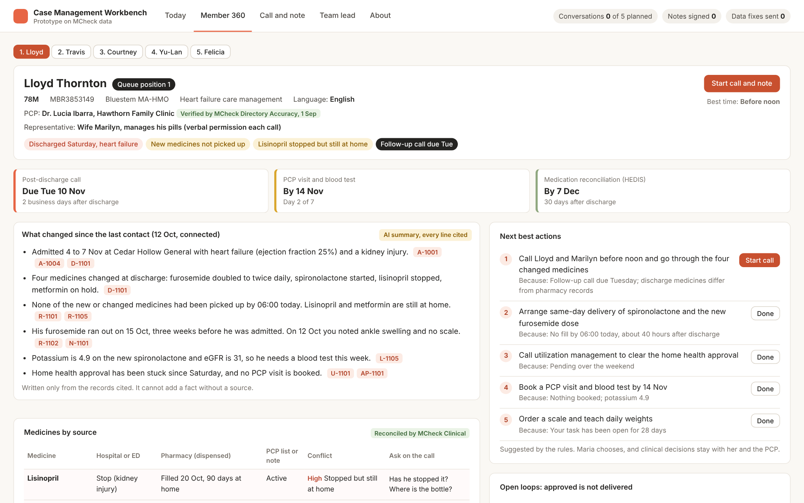
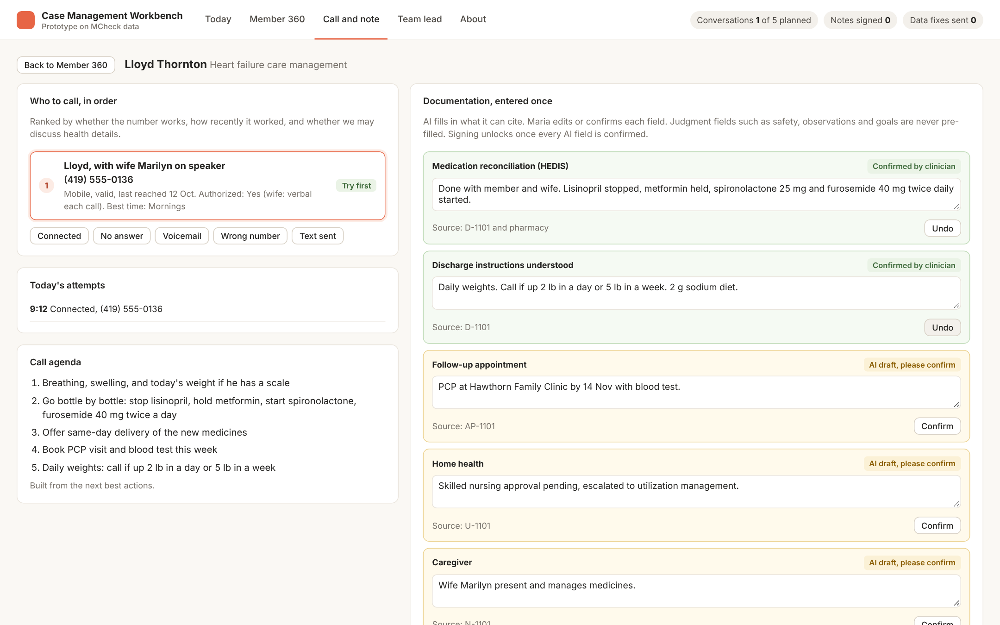
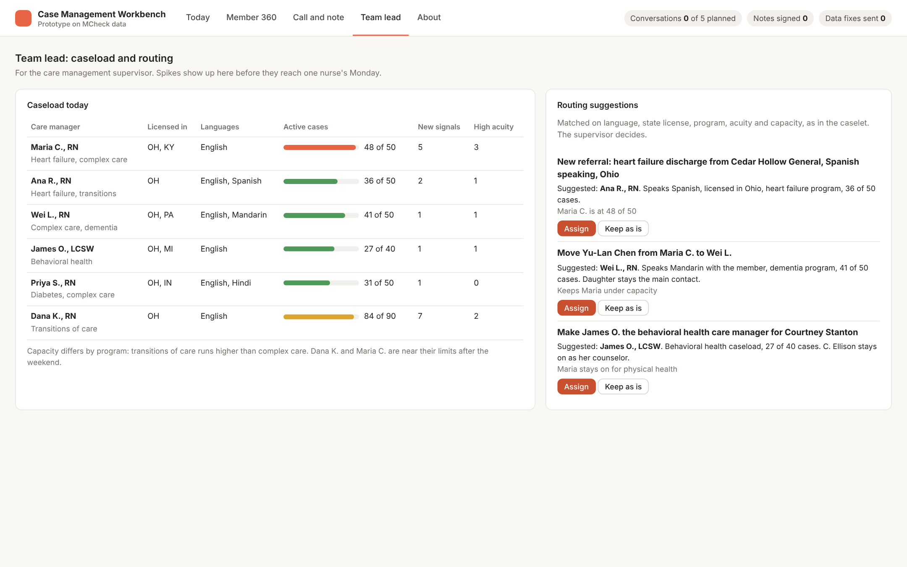

# Case Management Workbench

A clickable MVP prototype for health plan nurse case managers, built for the HiLabs product caselet 2026-27.

**Live prototype:** https://vedant464github.github.io/hilabs_prototype/

All members, providers, IDs and phone numbers are fictional. No real patient data is used.

## The problem

A nurse case manager with 48 cases opens six or seven systems per member, works from data that is weeks old, dials numbers that no longer work and types the same facts into four forms. She manages about two real conversations a day. The Workbench gives her back that time: who to call today, one trusted page per member, and a note written once.

## Screens

### Today
Ranks the members with new signals using rules anyone can read. "Why" shows the points behind each rank, each card says why now in plain words, and the day plan times each call for when the person can answer. The clinical lead can tune the weights and the queue re-ranks live.

### Member 360
One page per member: deadlines on top, a summary of what changed where every line links to its record, medicines side by side by source with conflicts flagged (never settled automatically), next best actions with reasons, a timeline showing when each event happened and when the plan found out, open loops, quality gaps, social needs and source freshness. Any record can be reported as wrong, which sends a data quality ticket to MCheck.

### Call and note
Contacts ranked by whether the number works and whether health details may be discussed, one-click outcomes, a call agenda, and AI-drafted note fields. Drafts stay amber until the nurse confirms each one; safety, observations and goals are never pre-filled. One signature files the note to the assessment, care plan, contact note and quality record.

### Team lead
Caseload against capacity for the care management team, with routing suggestions matched on language, state license, program, acuity and capacity.

## Two-minute demo

1. On **Today**, click **Why** on Lloyd, then move a weight under **Tune the rules**.
2. Click **Simulate a 09:12 pharmacy fill** and watch the queue update.
3. Open **Travis** in Member 360 and decide the 88% record match.
4. Click any coral record ID to see its source, then report it as wrong.
5. In **Call and note**, log an outcome, confirm the amber fields and sign.
6. On **Team lead**, assign a routing suggestion.

## Where HiLabs fits

The prototype assumes HiLabs MCheck underneath. MCheck Clinical standardizes clinical data (codes, units, medicine changes from documents). MCheck Directory Accuracy checks provider details such as a PCP's phone number.

## Files

| File | What it is |
|---|---|
| `index.html` | The whole prototype in one page, with no build step or backend. It also contains a plain-text version of every screen for readers and tools that do not run JavaScript. |
| `data.json` | Every member, record, rule, score and routing suggestion behind the screens, in plain JSON |
| `screenshots/` | The four screens shown above |

Record IDs in the app (for example D-1101 or R-5103) match the synthetic data annex submitted with the caselet.

## Run locally

Download `index.html` and open it in any modern browser. An internet connection is only needed for the Inter font.

## Author

Vedant Abhangrao, IIT Bombay
